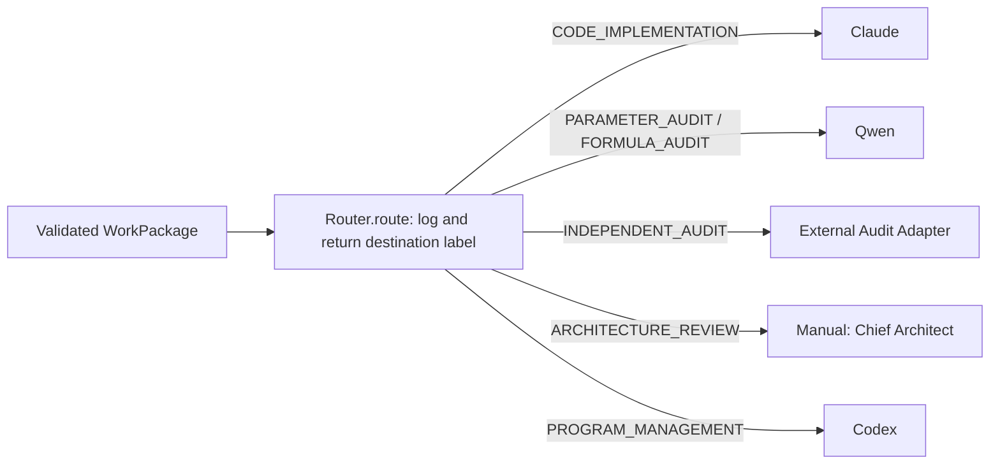
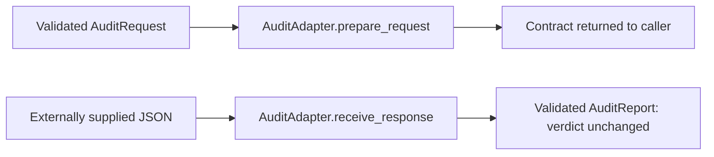

# Engineering Bridge Version 1.2 routing diagram

Arrows represent returned labels. The bridge does not invoke these destinations.

The audit adapter has no network implementation. The caller conducts the audit
outside the bridge. Existing Version 1.0 prompt requests continue through
Bridge → PromptRouter → OllamaClient → JSON persistence and logging.
