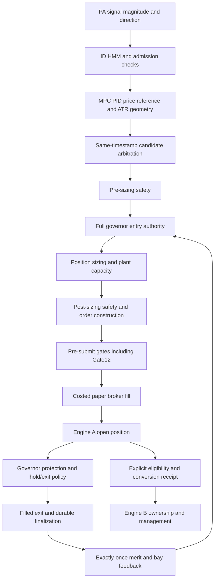

# R5 engine and frozen Block 1 repair findings

This is an engineering and paper-run activity report. It is not a profitability, live execution or complete direct-recovery certification. Final measured results and exact counters are in final/COMPARISON.md and final/COMPARISON.json after those runs finish. First-pass failures remain in FIRST_PASS_RECEIPT.json and the original per-arm directories.

## Reproduced problems and implemented solutions

1. **Geometric RR rounding.** MPC creates 1.5 reward/risk geometry, but subtraction of floating-point prices can reconstruct 1.49999999999998. The experimental A arm snaps only deficits in (0, 1e-12] on a copied EntrySignal; material RR deficits and the safety confidence threshold are untouched. First-pass actuation: 112 snaps, 59 trades and negative net P&L. It is a numerical repair, not evidence of edge.
2. **Unsigned terms inside directional PA.** Existing volatility and volume terms are added to signed momentum/VWAP, so reversing the directional inputs does not negate the score. The B arm moves those terms into a nonnegative magnitude modifier and preserves neutral directional amplitude. It does not change log-price normalization, PID tuning, sampling or admission thresholds. Helper oddness and direction invariants are tested. First-pass result: only one trade. This exposes the need to study magnitude calibration; it does not justify silently lowering the confidence hurdle.
3. **Non-monotonic amber confidence.** The frozen mapping drops confidence at raw 0.5 from approximately 0.5 to 0.425. C preserves the amber boundary with `0.5 + (raw - 0.5) * 0.85`; all thresholds and other band branches stay fixed. First-pass result: 65 trades, with negative gross and net P&L.
4. **Synthetic ID RR duplicates magnitude admission.** The ID formula is approximately `2*c/(1-c)`. At minimum RR 1.5 this imposes c >= 3/7 before MPC computes actual geometry. D approves only this named rejection, retaining every other ID rejection and real Gate12 protection. Warmup and scored overrides are separately counted. D is excluded from E. The first pass closed accounting but failed report serialization; it is not accepted as a completed run.
5. **Undefined Hilbert phase corrupts report JSON.** Exactly 63 aligned observations can produce a TA-Lib phase NaN. The external provider previously labeled that observation available. The adapter now emits unavailable reason `SYMBOL_GRID_PHASE_UNAVAILABLE` with null phase. Sealed V3 is unchanged. Real 63- and 64-observation fixtures prove the unavailable boundary and preservation of the first finite phase. The final runner records any remaining non-finite report paths and retains strict JSON serialization.
6. **PA recovery literal audit.** The new storage bound is explicitly classified in the AST audit; the existing deque reserve is shared by evaluation and recovery. The detector still rejects anonymous operational values. No horizon or parameter changed.
7. **Stale historical diagnostic patch.** The existing opt-in log-price/symmetry patch was rebased onto the extracted calibration and arithmetic helpers. Its policy-disabled behavior is compared with the current PA across actual signal evaluations and remains exact. This historical patch is distinct from B and is not applied in this comparison.

## Actual authority path

Sector bay ownership and Engine A/B lifecycle ownership are independent. MPC changes a market reference; it does not create a waiting/resting entry order. Gate12 consumes ID confidence as a magnitude, not a calibrated success probability. The full governor has actual hold/exit authority. The five first-pass completed arms had zero conversion requests, so those ledgers only exercise A ownership.

## Recovery work

D02 paper exit finalization and its duplicate suppression have verified focused and wider regressions. The final-source pre-C04 baseline ledger matched the accepted reference exactly. C04 protection, MPC, studies and PA staged hydration passed 331 focused tests. Additional ID/HMM and closed-loop outcome/hysteresis codecs now preserve fitted arrays, posterior/refit cadence and future-entry feedback reads; they have component continuity and malformed-state tests. They are not yet composed into a certified direct morning run.

Remaining direct-resume work is explicit: conviction histories/ranks; wiring ID and outcome/hysteresis codecs into the boot snapshot; per-symbol processed/entry cursors and reweight cadence; financial marks and realized account state; complete native-plant applicability; certified resumed-data identity; and a continuous-vs-restarted integrated decision/ledger fixture. Morning preparation continues to halt new admissions. Prefix reconstruction has a separate verified paper fixture and is not relabeled as complete direct hydration.

Live broker execution, protective fill continuity and actual account reconciliation remain outside these paper receipts. A deeper GTT limit is still a limit order and does not guarantee a fill.

## Verification and evidence rules

- Final six arms use identical frozen Trial000, protocol SHA, 48-stock and grid file hashes, five-session slice, safety values and current source tree.
- Every arm uses a fresh process and output/WAL path. Original failed directories are preserved.
- Native/passive ID, governor and final-gate accounting must reconcile, including warmup separation.
- The baseline must reproduce ledger SHA `311b3a145ab017739b492328389b6f79fd9aaa4ebf1eca751f12c9a644e5b08d` byte for byte.
- Changed policy arms are experimental; no default promotion is made from these results.
- Gross P&L already includes execution-price slippage. Engine costs are reported once; unmodeled taxes are not invented.
- No sealed V3, frozen parameter, holdout or raw reference output is changed. No live order, commit or push is performed.
